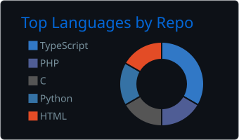
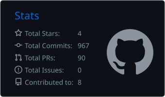

# Davi Morais Silva

**Desenvolvimento Back-End · Linux em laboratório**

Estudante de Análise e Desenvolvimento de Sistemas (3º período), em busca de **estágio ou primeira vaga júnior** em desenvolvimento back-end.

 

---

## Sobre

Gosto do que acontece por trás da interface: como uma API valida uma requisição, como serviços trocam informações, como os dados ficam consistentes quando várias operações acontecem ao mesmo tempo e como o sistema operacional sustenta tudo isso.

Hoje concentro meu tempo em duas frentes. A principal é uma plataforma de e-commerce em microsserviços, que uso para praticar back-end de forma incremental, por fases documentadas. A segunda é o estudo de Linux, feito em máquina virtual própria e registrado em um caderno de laboratório público, como preparação para a minha primeira certificação.

Não tenho experiência profissional na área até o momento. Tudo o que está descrito abaixo vem de projetos pessoais e de estudo, com o código e a documentação disponíveis para consulta.

---

## O que consigo demonstrar

- **APIs REST em Node.js e TypeScript**, com Express, validação de entrada e erros padronizados.
- **Autenticação e autorização** com hash de senha, JWT (access e refresh token), controle de acesso por papel e limite de tentativas de login.
- **Consistência de dados**: transações, constraints no banco, reservas de estoque seguras sob concorrência e idempotência por chave em operações que não podem se repetir.
- **Mensageria com RabbitMQ**: padrão outbox, consumo idempotente e fila de mensagens inválidas (dead-letter).
- **Testes automatizados** unitários e de integração contra PostgreSQL, além de uma suíte ponta a ponta executada localmente.
- **Linux no terminal**, em laboratório: hierarquia de diretórios, permissões, usuários e grupos, processos, redirecionamento, filtros e shell script.

---

## Projetos em destaque

### Plataforma de E-commerce com Microsserviços

[Repositório](https://github.com/DaviMoraisdev/ecommerce-platform) · [README do projeto](https://github.com/DaviMoraisdev/ecommerce-platform#readme) · [Parecer técnico de outubro de 2026](https://github.com/DaviMoraisdev/ecommerce-platform/blob/main/docs/parecer-geral-2026-10.md)

Projeto educacional desenvolvido desde maio de 2026, em fases. As fases 1 a 4 (fundação, autenticação, catálogo e estoque, carrinho e pedidos) estão concluídas; a fase 5, de pagamentos, está em andamento. O sistema roda apenas em ambiente local e não está em produção.

`Node.js` · `TypeScript` · `Express` · `PostgreSQL` · `Prisma` · `MongoDB` · `Redis` · `RabbitMQ` · `Jest` · `Docker Compose` · `GitHub Actions`

| Serviço | Situação | O que já faz |
|---|---|---|
| `auth-service` | Implementado | Registro com bcrypt, login com access e refresh token, papéis ADMIN, SELLER e BUYER, rate limit no login |
| `product-service` | Implementado | Catálogo em MongoDB com busca, filtro, paginação, soft delete e cache de listagens em Redis |
| `inventory-service` | Implementado | Reserva de estoque por pedido com `UPDATE` condicional, liberação idempotente e constraints `CHECK` no banco |
| `cart-service` | Implementado | Carrinho em Redis, com preço consultado no catálogo e total calculado no servidor |
| `order-service` | Implementado | Checkout como saga com compensação, `Idempotency-Key`, máquina de estados do pedido e outbox publicando no RabbitMQ |
| `payment-service` | Parcial | API de pagamento e reembolso, webhook com verificação de assinatura, outbox, reconciliação e expiração de pagamentos |
| `notification-service` | Parcial | Consome eventos de pedido com deduplicação em Redis e dead-letter queue; o envio real de e-mail ainda não existe |
| `user-service`, API Gateway e frontend | Planejado | Ainda não implementados |

**Sobre pagamentos.** O fluxo completo foi exercitado com um provedor simulado, usado em desenvolvimento e testes. Existe um adapter para a Stripe, testado com respostas HTTP simuladas; ele ainda não foi validado contra a API real da Stripe, etapa prevista para a continuação da fase 5.

**Testes e automação.** Os serviços têm testes unitários e de integração. O [workflow de CI](https://github.com/DaviMoraisdev/ecommerce-platform/blob/main/.github/workflows/ci.yml) executa typecheck, testes unitários, build e testes de integração contra PostgreSQL para `order-service` e `payment-service`; os demais serviços ainda são testados localmente. Não há implantação contínua. A [suíte ponta a ponta](https://github.com/DaviMoraisdev/ecommerce-platform/blob/main/e2e/README.md) cobre o fluxo carrinho, pedido e estoque, concorrência sem venda acima do estoque e o caminho assíncrono até o RabbitMQ, executada manualmente contra o ambiente local.

**Infraestrutura local.** O [`docker-compose.yml`](https://github.com/DaviMoraisdev/ecommerce-platform/blob/main/docker-compose.yml) sobe PostgreSQL, MongoDB, Redis e RabbitMQ. Os serviços da aplicação ainda rodam diretamente com Node.js; a containerização deles está planejada.

As pendências conhecidas ficam registradas em [`docs/TECH_DEBT.md`](https://github.com/DaviMoraisdev/ecommerce-platform/blob/main/docs/TECH_DEBT.md).

### Linux Essentials Labs

[Repositório](https://github.com/DaviMoraisdev/linux-essentials-labs) · [Plano de estudos](https://github.com/DaviMoraisdev/linux-essentials-labs/blob/main/PLANO.md) · [Montagem do laboratório](https://github.com/DaviMoraisdev/linux-essentials-labs/blob/main/SETUP-LAB.md)

Caderno de laboratório da preparação para o LPI Linux Essentials, mantido desde agosto de 2026. É experiência de estudo, não de administração de servidores em produção.

`Ubuntu Server` · `VirtualBox` · `Bash` · `SSH` · `Docker`

- VM Ubuntu Server montada do zero, com LVM, acesso por SSH e snapshot para restaurar o sistema depois de testes destrutivos.
- Diário semanal com os comandos executados, as saídas e uma seção de correções do que foi anotado de forma errada.
- Shell scripts escritos durante o estudo do objetivo de script do exame.
- Simulados no formato da prova, com apuração por tópico.
- Prática complementar no wargame OverTheWire Bandit (níveis 0 a 9).

### Outros repositórios

- [Desenvolvimento-em-Python](https://github.com/DaviMoraisdev/Desenvolvimento-em-Python): exercícios de um curso de Python, com fundamentos, orientação a objetos, tratamento de erros e um projeto final de controle de portaria com testes em `pytest`.
- [Portfolio2026](https://github.com/DaviMoraisdev/Portfolio2026): código-fonte do meu portfólio pessoal em Next.js, React e TypeScript.

---

## Tecnologias

**Utilizadas nos projetos acima**

Também em projetos de menor porte: Python, Next.js e React.

**Em estudo ou planejadas, ainda sem uso em projeto**

Administração de sistemas Red Hat, Nginx como API Gateway, containerização dos serviços com Dockerfile, AWS. Kubernetes, Terraform e Ansible aparecem apenas como metas de longo prazo no meu plano de estudos.

---

## Estudo atual e certificações

Ainda não tenho certificações obtidas.

| Certificação | Situação | Previsão |
|---|---|---|
|  |  | Novembro de 2026 |
|  |  | Próxima etapa |

A trilha completa, com as certificações seguintes e as metas de longo prazo, está em [`docs/certificacoes.md`](docs/certificacoes.md). O roadmap de estudos e as ideias de projetos futuros estão em [`docs/roadmap.md`](docs/roadmap.md).

---

## Atividade no GitHub

<!-- Gerada diariamente pelo workflow .github/workflows/snake.yml -->
<picture>
  <source media="(prefers-color-scheme: dark)" srcset="https://raw.githubusercontent.com/DaviMoraisdev/DaviMoraisdev/output/github-snake-dark.svg" />
  <source media="(prefers-color-scheme: light)" srcset="https://raw.githubusercontent.com/DaviMoraisdev/DaviMoraisdev/output/github-snake.svg" />
  
</picture>

  

<!-- Gerados pelo workflow .github/workflows/profile-summary-cards.yml -->

---

## Contato

Aberto a oportunidades de **estágio** e **vagas júnior** em desenvolvimento back-end.

